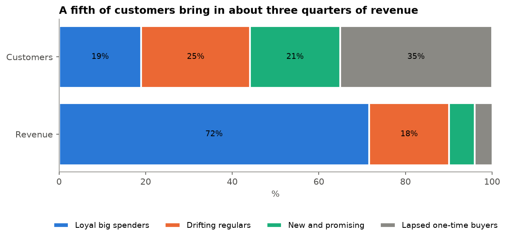
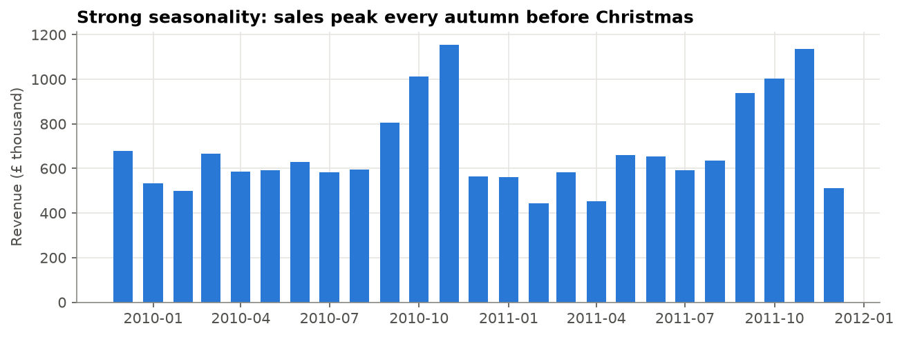
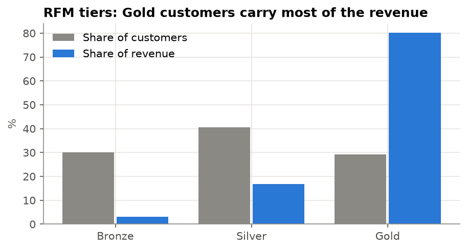
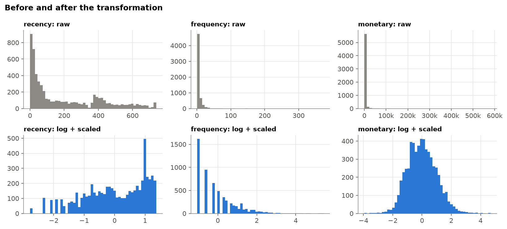
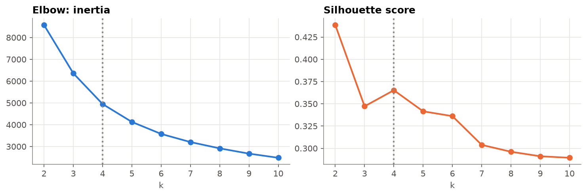
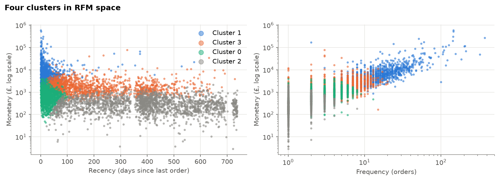

# Customer Segmentation: RFM and K-means for Targeted Campaigns

**Four customer segments that tell marketing where to spend, who to win back, who to grow and who to stop chasing.**

Built on two years of transactions from an online gift and homeware retailer (5,852 customers, £17 million), framed for a South African online retailer.

| | |
|---|---|
| **Question** | Everyone gets the same email. Which natural customer groups exist, and what should each one hear? |
| **Method** | RFM scores by hand as a baseline, then K-means on log-scaled RFM, k chosen by silhouette and business use |
| **Result** | 4 segments. **Loyal big spenders: 19% of customers, 72% of revenue.** K-means also split the RFM "Silver" tier into new customers and drifting regulars, who need opposite messages. |
| **Validated** | Segments built on older data predicted the next six months: the top segment spent **19 times** as much as lapsed buyers |
| **Output** | [`reports/segments.csv`](reports/segments.csv): every customer's segment, ready for an email platform |



## 1. Business problem

**Client and context.** The imagined client is a South African online retailer of gifts and homeware that sells to individual shoppers and to small shops (gift stores, decor boutiques). Today marketing sends **everyone the same email**: the same products, the same discount, the same timing.

**Question.** Which natural groups exist in the customer base, and what should marketing say to each?

**What marketing would do differently per segment:**

- **Where to spend:** loyalty perks and account management for the most valuable customers, instead of discounts they do not need.
- **Who to win back:** customers who used to buy regularly and have gone quiet, while they are still worth saving.
- **Who to grow:** new customers who need a reason to place their next order.
- **Who to stop chasing:** long-lost one-time buyers, kept only in low-cost seasonal campaigns.

**What a good result looks like.** A handful of segments (three to five) that are clearly different, easy to describe in one sentence, large enough to run a campaign for, and that **predict future buying** rather than only describing the past. Segments a marketing manager cannot name or act on are not useful, however good the statistics.

## 2. Data

**Source:** [Online Retail II](https://archive.ics.uci.edu/dataset/502/online+retail+ii), UCI Machine Learning Repository, id 502 (CC BY 4.0). Every transaction of a UK-based online gift and homeware retailer from 1 December 2009 to 9 December 2011: 1,067,371 invoice lines in an Excel workbook with one sheet per year. Many of its customers are small shops buying in bulk, which is the same mix as the imagined client.

| Column | Meaning |
|---|---|
| `Invoice` | Invoice number. Starts with **C** for a cancellation, **A** for a bad-debt adjustment. |
| `StockCode` | 5-digit product code, sometimes with a variant letter (`85123A`). Non-products include `POST` (postage), `M` (manual), `BANK CHARGES`, `AMAZONFEE`. |
| `Description` | Product name |
| `Quantity` | Units on the line; negative for cancellations |
| `InvoiceDate` | Date and time of the invoice |
| `Price` | Unit price in pounds sterling |
| `Customer ID` | Customer number; missing for almost a quarter of lines |
| `Country` | Customer's country (91% of customers are in the UK) |

**Currency.** Amounts are in pounds. I keep them in pounds rather than inventing an exchange rate; the segments and campaigns translate directly to a rand-based business.

**South African data in a real role:** the retailer's own e-commerce order history and loyalty programme data, processed under POPIA. Customer-level retail data is rarely public in South Africa, which is why an international dataset is used here.

## 3. Cleaning

Every rule is applied in order and counted:

| Rule | Lines removed | Lines left |
|---|---|---|
| Raw data | | 1,067,371 |
| Exact duplicate lines | 34,335 | 1,033,036 |
| No Customer ID (cannot be linked to a customer) | 235,151 | 797,885 |
| Cancellations (invoice starts with C) | 18,390 | 779,495 |
| Non-product lines (postage, fees, manual entries) | 2,858 | 776,637 |
| Zero or negative quantity or price | 60 | **776,577** |

Cancellations are **removed, not subtracted**: many refer to orders placed before the data starts, and subtracting them would leave some customers with negative spend. Revenue per line is `Quantity x Price`.

**Result:** 5,852 customers, 36,594 orders, £17.1 million in revenue.



- Sales are **strongly seasonal**, peaking in October and November before Christmas.
- Revenue is **very concentrated**: the top 10% of customers bring in 64% of it.
- Almost a quarter of all lines have **no Customer ID**. That revenue is real but cannot be segmented; in a real project I would ask why (for example, guest checkout).

## 4. Baseline: RFM by hand

For every customer, measured on 10 December 2011:

- **Recency:** days since the last order
- **Frequency:** number of orders
- **Monetary:** total spend

Each is scored 1 to 5 by quintile (5 = best) and the three scores are added (3 to 15) into tiers:

| Tier | RFM score | Customers | Median days since last order | Median orders | Median spend | Share of revenue |
|---|---|---|---|---|---|---|
| Gold | 12 to 15 | 1,711 (29%) | 18 | 10 | £3,628 | **80%** |
| Silver | 7 to 11 | 2,378 (41%) | 96 | 3 | £852 | 17% |
| Bronze | 3 to 6 | 1,763 (30%) | 418 | 1 | £240 | 3% |



**What I expected before clustering:** a small high-value group carrying most of the revenue; a large group of long-gone one-time buyers; and, hidden inside Silver, two groups that need opposite messages: **new customers** (recent, few orders) and **regulars drifting away** (several orders, not recent). If K-means separates those two, it is worth its extra complexity.

## 5. K-means clustering

**Preparation.** Recency, frequency and monetary are all heavily skewed (the biggest customer spent £581,000; the median £856), and they are in different units. K-means works on distances, so without care the few giant customers would dominate. Each value is **log-transformed** (`log1p`) and **standardised** (mean 0, standard deviation 1).



**Choosing k** (number of clusters), for k = 2 to 10:

| k | 2 | 3 | **4** | 5 | 6 |
|---|---|---|---|---|---|
| Silhouette | 0.438 | 0.347 | **0.365** | 0.342 | 0.336 |



The silhouette score is highest at k = 2, but "good customers and the rest" adds nothing the RFM tiers do not already say. **k = 4 is a local peak**, the elbow bends around 4 to 5, and four is a number of campaigns a marketing team can run. Statistics narrows the choice; the business use makes it.

**The four clusters:**

| Cluster | Customers | Median days since last order | Median orders | Median spend | Share of revenue |
|---|---|---|---|---|---|
| A | 1,110 (19%) | 15 | 13 | £5,118 | 72% |
| B | 1,468 (25%) | 157 | 5 | £1,580 | 18% |
| C | 1,220 (21%) | 23 | 3 | £708 | 6% |
| D | 2,054 (35%) | 398 | 1 | £291 | 4% |



## 6. Evaluation

**Agreement with the RFM tiers:**

| Cluster | Gold | Silver | Bronze |
|---|---|---|---|
| A: recent, frequent, high spend | **100%** | 0% | 0% |
| B: several orders, not recent | 24% | **76%** | 0% |
| C: recent, few orders | 21% | **75%** | 4% |
| D: one order, long ago | 0% | 17% | **83%** |

K-means rediscovered the obvious groups on its own (A is Gold, D is Bronze), which suggests the clusters are real. Where they disagree is where the value is: **B and C are both mostly Silver**, because their RFM totals are similar, but one is drifting away and the other has just arrived. The tiers lump them together; the clusters split them, as hoped in Step 4.

**Do the segments predict the future?** I rebuilt the whole pipeline on data up to 9 June 2011 only, then measured what each segment did in the **next six months**, which the clustering never saw:

| Segment found on past data | Customers | Bought again | Average spend, next 6 months |
|---|---|---|---|
| Recent, frequent, high spend | 722 | **93%** | **£4,075** |
| Recent, few orders | 633 | 70% | £553 |
| Several orders, not recent | 1,499 | 57% | £529 |
| One order, long ago | 2,090 | 28% | £210 |

The top segment's customers spent about **19 times** as much in the following six months as the lapsed segment's. The segmentation ranks future value, not just past behaviour, which is what marketing needs to decide where to spend.

## 7. Segments and campaigns


| Segment | Customers | Share of revenue | Who they are | Campaign |
|---|---|---|---|---|
| **Loyal big spenders** | 1,110 (19%) | 72% | Ordered in the last few weeks, 13 orders, median spend £5,118 | **Protect and reward.** Early access to new collections, a named account contact, free delivery on bulk orders. No discounts: they already buy at full price. |
| **Drifting regulars** | 1,468 (25%) | 18% | 5 orders, but none for about five months | **Win back now.** A personal "we miss you" email with their past favourite products and a time-limited offer. The segment most at risk, and still worth saving. |
| **New and promising** | 1,220 (21%) | 6% | Ordered in the last few weeks, but only 3 orders and small baskets | **Grow the habit.** A welcome series with best-sellers and a small incentive on the next order. |
| **Lapsed one-time buyers** | 2,054 (35%) | 4% | One order, over a year ago, median £291 | **Low-cost reactivation only.** Include in the October seasonal campaign; drop from frequent emails to protect sender reputation. |

Every customer's segment, RFM values and tier are in [`reports/segments.csv`](reports/segments.csv), ready to load into an email platform. The summary is in [`reports/segment_summary.csv`](reports/segment_summary.csv).

## 8. Recommendation

1. **Stop the single email.** Load `reports/segments.csv` into the email platform and run four campaigns.
2. **Put the effort into the two middle segments.** Loyal big spenders mostly need not to be annoyed; lapsed buyers are cheap to keep in a seasonal campaign. The real gains are in turning **new and promising** customers into regulars, and catching **drifting regulars** before they lapse.
3. **Time it with the season.** Run the win-back campaign in August and September, so drifting regulars are back before the October and November peak.
4. **Refresh monthly.** Customers move between segments. A drifting regular who orders again should leave the win-back list straight away.
5. **Measure with a holdout.** Keep a random 10% of each segment out of its campaign and compare their spend after three months. That is the only way to know a campaign caused the change.

## Limitations

- **Only purchase history.** RFM sees what customers bought, not why. There is no data on interests, household or business type, channel or browsing, which would sharpen the segments. In a real role I would add those, especially whether a customer is a shop or an individual.
- **Almost a quarter of lines are anonymous** and could not be segmented.
- **K-means assumes round, similar-sized clusters** and will always produce k groups, even if the data has no natural groups. The agreement with RFM tiers and the six-month test are the evidence that these groups are real.
- **UK data from 2009 to 2011.** The method transfers; the exact segment sizes and thresholds would not.
- **Pounds, not rand.** No conversion is made, because the decisions depend on relative value, not the currency.

## Next steps

- Add product categories (what each segment buys) to tailor the content of each campaign, not only its tone.
- Estimate customer lifetime value per segment to set a budget for each campaign.
- Test other clustering methods (Gaussian mixtures) to see if the segment boundaries are stable.

## How to run

```bash
git clone https://github.com/vusumuzinkosi/customer-segmentation-rfm.git
cd customer-segmentation-rfm
python3 -m venv .venv && source .venv/bin/activate
pip install -r requirements.txt
jupyter notebook
```

Run the notebooks in order. The first downloads the data (about 45 MB) from UCI into `data/raw/` if needed; reading the Excel file takes about a minute.

## Project structure

```
notebooks/
  01_clean.ipynb     load, data dictionary, cleaning rules, revenue
  02_rfm.ipynb       RFM scores and tiers by hand (the baseline)
  03_kmeans.ipynb    transformation, choosing k, clusters, comparison with tiers, future test, segment names
figures/             charts used in this README
reports/
  segments.csv         every customer's RFM values, tier and segment
  segment_summary.csv  one row per segment
data/                raw and processed data (not committed)
```

*Author: Vusumuzi Nkosi ([GitHub](https://github.com/vusumuzinkosi))*
